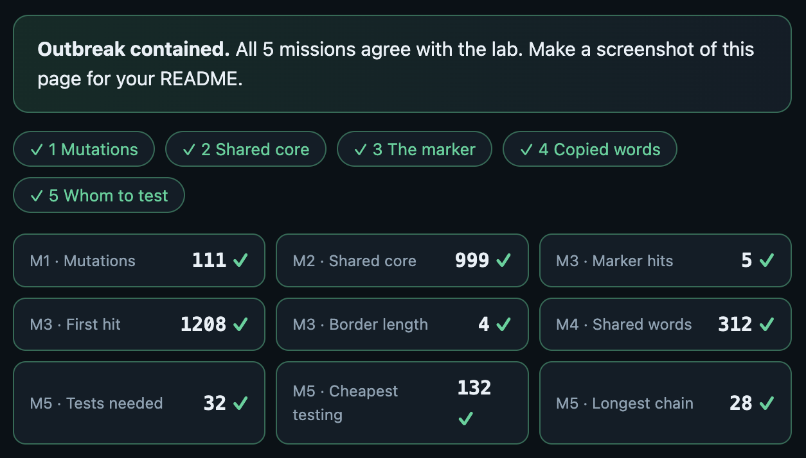

# Assignment 4. Patient Zero

Student ID: 254093
Name: Ashimbay Kaisar
Group: Se-2540

This file is the report. Fill it in as you go. How to start: `START_HERE.md`. The task: `docs/Assignment4.pdf`.

## Program output

The 9 lines your program prints on your data (`java -cp out Main`):

Mutations: 111
Shared core: 999
Marker hits: 5
First hit: 1208
Border length: 4
Shared words: 312
Tests needed: 32
Cheapest testing: 132
Longest chain: 28

My outbreak report (a screenshot of `output/outbreak.html`):

## Questions

Answer in your own words, two or three sentences each.

Mission 1. What does the cell d[i][j] of your table mean, and how is it computed from other cells?
The cell d[i][j] is the smallest number of changes (replace, insert, delete) that turn the first i letters of A into the first j letters of B. It is the minimum of three cells: the diagonal d[i-1][j-1] (plus 1 if the letters differ, plus 0 if they are equal), the top cell d[i-1][j] + 1 (delete a letter of A) and the left cell d[i][j-1] + 1 (insert a letter of B). The first row and the first column are j and i, because turning a word into an empty word (or the opposite) costs one change per letter.

Mission 2. How is the longest common subsequence different from the longest common substring? My Shared core is bigger than the number of letters that are the same at the same place: why?
A common subsequence keeps the order of the letters but the letters do not need to be next to each other, while a common substring must be one continuous piece. My Shared core is bigger than the number of letters equal at the same place because insertions and deletions shift the letters of one strain, so many letters still match in the same order but at different positions. LCS uses the same table, but when the letters are equal it takes the diagonal + 1, and otherwise the maximum of the top and left cells.

Mission 3. What does the prefix function tell you, and why does the pointer in the text never go back in KMP? What is the Border length of my marker and what does it mean?
The prefix function pi[i] is the length of the longest proper prefix of the marker that is also a suffix of its first i+1 letters. In KMP, when a letter does not match, I only move the number k of matched marker letters back to pi[k-1]. The pointer in the text never goes back, because the last k letters of the text are already known to equal the beginning of the marker, so I do not have to read them again. After a full match I also set k = pi[m-1], so overlapping matches are found. The Border length of my marker is 4: the first 4 letters of my marker <ВАШ МАРКЕР> are the same as its last 4 letters. It means that two occurrences of the marker can overlap by 4 letters.

Mission 4. Why must you compare the letters after the hashes are equal? What happens to the cost of Rabin-Karp if many windows have the same hash?
Two different words can have the same hash (a collision), so equal hashes do not prove equal words. That is why I compare the letters before I count a position. If many windows have the same hash, every check needs a letter comparison of k letters, so the time grows from O(n + m) towards O(n·k).

Mission 5. What are the two states of a person in your DP, and how do you get the answer for a person from its children? Why does a greedy "test the person with most links first" not always give the cheapest answer?
Every person has two states: in[v] is the cheapest cost of the subtree of v when v is tested, out[v] is the cheapest cost when v is not tested. in[v] = cost[v] + the sum over children of min(in[c], out[c]). out[v] = the sum over children of in[c], because if v is not tested, every child must be tested to cover the link. The answer is min(in[0], out[0]) at the root. Greedy “test the person with the most links first” does not always work because it ignores the costs and the whole structure: an expensive person with many links can be worse than testing several cheap neighbours, and a choice that looks good locally can force expensive tests elsewhere.

## AI use

I used Claude to explain the assignment and the algorithms and to help write the code for Missions 1–5 and a draft of the README. I read and tested the code and rewrote the answers in my own words

## Timing (Mission 7)

Milliseconds, average of 3 runs, from `java -cp out Bench`.

A. Looking for 'AAAA...AAB' (length 2000) in a text of only A letters: naive loop and your KMP, milliseconds (average of 3 runs)
   text  20000   naive     29.8 ms   KMP    1.6 ms
   text  40000   naive     75.6 ms   KMP    0.8 ms
   text  80000   naive    161.3 ms   KMP    0.3 ms
B. Your edit distance on two random strains, milliseconds (average of 3 runs)
   length   500   edit distance     5.5 ms
   length  1000   edit distance     5.3 ms
   length  2000   edit distance    13.3 ms
   length  4000   edit distance    51.5 ms

What do the numbers say about how the time grows? When you double the size, by how much does each time grow? Two or three sentences.
The naive search grows roughly twice when the text size doubles (29.8 → 75.6 → 161.3 ms), which matches O(n·m): the pattern length m is fixed at 2000 and the text length n grows, and on a text of only A letters the naive loop compares almost the whole pattern at every position.

## Complexity

n is the length of the text (or of a strain), m the length of the pattern, k the length of the window, v the number of people. Fill in every algorithm you wrote.

| Algorithm | Time | Space | Assumptions |
|---|---|---|---|
| Edit distance | O(n·m) | O(n·m) | full table (n+1)×(m+1), two strings of lengths n and m |
| LCS | O(n·m) | O(n·m) | same table size as edit distance |
| Prefix function and KMP | O(n + m) | O(m) | text length n, pattern length m; the text pointer never goes back |
| Rabin-Karp (shared words) | O(n + m) average, O(n·k) worst case | O(m) | window size k; the worst case is when many windows have equal hashes |
| Tree DP | O(v) | O(v) | every person is visited once, v people |

## Before you submit

- The four files in `data` and the screenshot `output/outbreak.png` are in the repository.
- `java tools/Check.java` shows all examples right.
- This README is filled in, the program output and the section AI use included.
- The work is pushed to main (at least one commit per mission) and the repository is public.
- The link is attached in Moodle.
